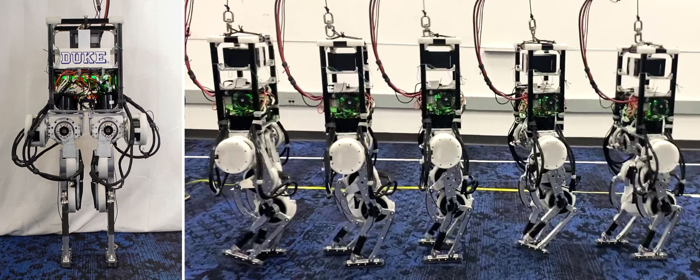

# The Duke Humanoid: Design and Control For Energy Efficient Bipedal Locomotion Using Passive Dynamics
Boxi Xia, 
Bokuan Li, 
Jacob Lee, 
Michael Scutari, 
[Boyuan Chen](http://boyuanchen.com/)
<br>
Duke University
<br>

<a href="https://www.youtube.com/watch?v=RZYkb09JurU"></a> <a href="https://www.youtube.com/watch?v=RZYkb09JurU"></a>

> **Update:** [Duke Humanoid V2](https://github.com/generalroboticslab/duke_humanoid_v2) ([paper](https://arxiv.org/abs/2609.08905)) is out. A humanoid can often reach targets it cannot see from the reaching pose. V2's two actuated RGB-D cameras raise visible-reachable coverage from 38% to 97%, so it can watch and grasp two separate targets without turning its torso.
>
> <a href="https://github.com/generalroboticslab/duke_humanoid_v2"></a>

## Abstract
We present the Duke Humanoid, an open-source 10-degrees-of-freedom humanoid, as an extensible platform for locomotion research. The design mimics human physiology, with minimized leg distances and symmetrical body alignment in the frontal plane to maintain static balance with straight knees. We develop a reinforcement learning policy that can be deployed zero-shot on the hardware for velocity-tracking walking tasks. Additionally, to enhance energy efficiency in locomotion, we propose an end-to-end reinforcement learning algorithm that encourages the robot to leverage passive dynamics. Our experiment results show that our passive policy reduces the cost of transport by up to 50% in simulation and 31% in real-world testing. 

<br>
<a href="https://www.youtube.com/watch?v=RZYkb09JurU">
   
</a>

### 🌐 <a href="http://generalroboticslab.com/DukeHumanoidv1/" target="_blank">Project</a>  |  🎥 <a href="https://www.youtube.com/watch?v=RZYkb09JurU" target="_blank">Video</a>  |  📄 <a href="https://ieeexplore.ieee.org/document/11246828" target="_blank">Paper</a>  |  <a href="https://arxiv.org/abs/2409.19795" target="_blank"></a>  |  🔧 <a href="https://www.notion.so/Duke-Humanoid-V1-38d54de887d1403a82f2367490c45b89" target="_blank">Hardware wiki</a> 


## Citation

If you find our paper or codebase helpful, please consider citing:

```
@inproceedings{xia2025duke,
  title={The Duke Humanoid: Design and control for energy-efficient bipedal locomotion using passive dynamics},
  author={Xia, Boxi and Li, Bokuan and Lee, Jacob and Scutari, Michael and Chen, Boyuan},
  booktitle={2025 IEEE/RSJ International Conference on Intelligent Robots and Systems (IROS)},
  pages={6579--6586},
  year={2025},
  organization={IEEE}
}
```

## project structure
```
.
├── control     # contains the hardware control code
├── doc
├── legged_env  # contains the simulation and RL code
├── LICENSE
└── README.md
```
## clone
Clone with submodules and follow the instructions in the respective submodules.
```bash
git clone --recurse-submodules https://github.com/generalroboticslab/DukeHumanoidv1.git
```
